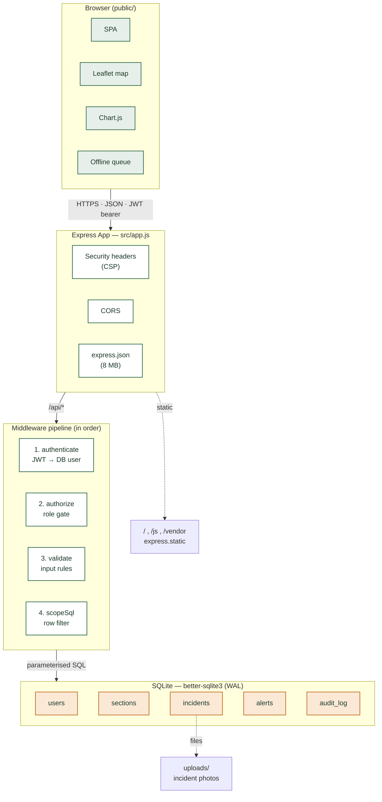

Here is an upgraded, portfolio-ready version of your `README.md`. 


---

# SANParks FRIMS — Field Ranger & Incident Management System

Node.js + Express + SQLite (better-sqlite3) + JWT, with a single-page front-end served from the same app. Includes offline-first data capture, server-side severity triage, and a built-in rule-based AI assistant.

*(Caption: The Section Ranger dashboard, showing live stats, map, and alerts.)*

## 🚀 Run it (2 minutes)

```bash
npm install
npm start
# open http://localhost:3000
```

Requires **Node 20 or newer**. The SQLite database (`data/frims.db`) is created and seeded automatically on first run. No `.env` file is needed locally. 

**Run the tests:**
```bash
npm test
```

---

## 🏗 System Architecture



---

## 🔐 Demo Accounts

| Role                 | Username     | Password     | Lands on                          |
|----------------------|--------------|--------------|-----------------------------------|
| Field Ranger         | `t.nkosi`    | `Ranger@123` | Mobile log-incident screen        |
| Section Ranger       | `s.mahlangu` | `Ranger@123` | Dashboard (Kruger South)          |
| Regional Ecologist   | `ecologist`  | `Eco@123`    | Dashboard (all sections, read-only) + audit log |
| System Administrator | `admin`      | `Admin@123`  | Dashboard + user management + audit log |

Others: `m.dlamini`, `k.vanwyk`, `n.zulu` (field rangers, Kruger South), `j.botha` (section ranger, Kruger North), `p.molefe` (field ranger, Kruger North) — password `Ranger@123`.

---

## 📱 Live Demo & Screenshots

### 1. Mobile Incident Logging
Rangers can log incidents from the field. The screen captures GPS, allows a photo upload (downscaled for weak connections), and shows a real-time AI severity tag. It is fully responsive for phone screens.


### 2. Automated Escalation & Alerts
If the server-side triage detects a High severity incident, it is automatically set to *Escalated* and raises an alert for section rangers.


### 3. Audit Trail
Every action (login, incident creation, status change, user deactivation) is logged immutably for compliance.


---

## 🛡 What each role can do

| Capability                                   | Field Ranger | Section Ranger | Ecologist | Admin |
|----------------------------------------------|:-:|:-:|:-:|:-:|
| Log incidents (GPS, photo, live severity tag, works offline) | ✔ | | | |
| See own incidents                            | ✔ | | | |
| See incidents, stats, map, alerts            | | own section | all (filter by section) | all (filter by section) |
| Escalate / resolve / reopen incidents        | | own section | | ✔ |
| Export CSV / print PDF                       | | own section | all | all |
| View audit log                               | | | ✔ | ✔ |
| Create / edit / deactivate users             | | | | ✔ |

Scoping is enforced **on the server** (`src/scope.js`), not just hidden in the UI.

---

## ⚙️ How it works

- **Severity Triage**: Calculated server-side (`src/triage.js`, rule-based: type + keywords). The client cannot choose severity or status. High → status *Escalated* and alert raised.
- **Offline Queue**: If the network is down, reports are saved in `localStorage` and auto-synced later. A `client_id` makes retries idempotent, so nothing is duplicated.
- **Built-in Chatbot**: A deterministic, offline assistant (`src/routes/chat.js`). It answers how-to questions, scores incident descriptions live, and queries the database respecting the user's scope (e.g., "how many incidents are open?").
- **Security**: 
  - bcrypt hashes, strict Content-Security-Policy.
  - JWT re-checked against the DB on every request (deactivating a user takes effect immediately).
  - Parameterised SQL, HTML-escaped output, CSV formula-injection protection.
  - Login rate-limiting (10 fails / 15 min), image-type whitelist.

---

## 📂 Project layout

```
server.js              start-up
src/app.js             express app (headers, routes, static files)
src/db.js              schema, indexes, seed data
src/auth.js            JWT + bcrypt helpers
src/middleware.js      authenticate, authorize, validate, error handlers
src/scope.js           role-based data scoping
src/triage.js          severity rules        
src/audit.js           audit trail
src/routes/            auth, incidents, users, alerts, reports, audit, chat
public/                index.html, styles.css, js/api.js, js/app.js, vendor/ (Leaflet, Chart.js)
tests/api.test.js      unit + integration tests (node:test)
render.yaml            Render blueprint       
.github/workflows/     CI + deploy
```

---

## 🔌 REST API (all JSON; except login/health need `Authorization: Bearer <token>`)

| Method & path | Purpose | Roles |
|---|---|---|
| `POST /api/auth/login` · `GET /api/auth/me` | sign in / current user | any |
| `GET /api/incidents` (`status,severity,type,section_id,from,to,q,limit`) | list (scoped) | any |
| `GET /api/incidents/stats` · `GET /api/incidents/:id` | dashboard stats / detail + audit trail | any (scoped) |
| `POST /api/incidents/triage` | severity preview | any |
| `POST /api/incidents` | log incident | field & section ranger |
| `PATCH /api/incidents/:id` | change status/severity | section ranger, admin |
| `GET /api/alerts` · `PATCH /api/alerts/:id/read` · `PATCH /api/alerts/read-all` | alerts | section ranger, ecologist, admin |
| `GET /api/reports/incidents.csv` (or `.json`) | export | section ranger, ecologist, admin |
| `GET/POST /api/users` · `PATCH/DELETE /api/users/:id` · `GET /api/users/sections` | user admin | admin |
| `GET /api/audit` | audit log | admin, ecologist |
| `POST /api/chat` | AI assistant | any |
| `GET /api/health` | health check | public |

---

## ☁️ CI/CD & Deploy to Render

This project uses GitHub Actions for continuous integration and Render for hosting.


1. Push to GitHub. CI runs tests on Node 22 and 24.
2. In Render, choose **New → Blueprint** and select the repo (`render.yaml` configures everything; `JWT_SECRET` is generated).
3. Copy the Render **Deploy Hook** URL into a GitHub repo secret named `RENDER_DEPLOY_HOOK`. Every push to `main` that passes tests deploys automatically.
4. Branching strategy: `feature/*` → PR into `develop` → PR into `main`.

**Render free plan note:** the disk is ephemeral, so data and photos reset when the service restarts (demo data is re-seeded). See comments in `render.yaml` for adding a persistent disk.

---

## ⚠️ Before real-world use

- Remove the demo-account buttons from `public/index.html` and change the seeded passwords.
- The map needs internet access for OpenStreetMap tiles; everything else is served locally.
- Uploaded photos are served from `/uploads/<random name>` without a login (names are unguessable); put them behind auth if that is not acceptable.
